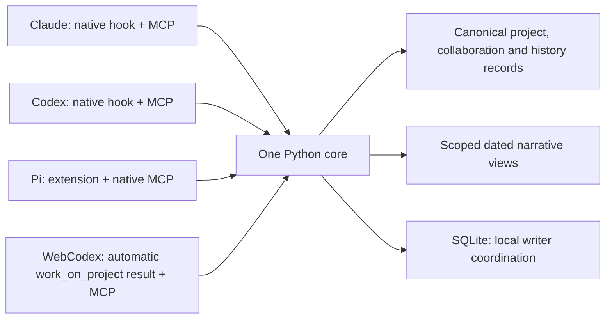

<p align="center"></p>

# shared-memory-mcp

Shared Markdown memory for **Claude Code, Codex CLI, Pi/Pi Web, and WebCodex**, preserving each harness's independent native memories. Scoped knowledge and manually initiated Dreaming use one MCP/CLI integration.

The initial deployment stores data at `/data/CoordExp/.shared-memory/`. Source lives in this independent repository. Sessions keep their existing working directories; the central registry chooses applicable project, worktree, and task records.

## Architecture



The core uses Python's standard library; stdio uses the official MCP SDK. Consumers resolve one store and current grants. A unified MCP surface retains ordinary records, scoped collaboration preferences, non-default historical episodes and bounded manual DreamRuns. There is no daemon, embedding service, automatic Git commit, paid synthesis or mandatory search index.

```text
shared-data-root/
├── registry.json
├── records/<stable-project-id>/<record-id>.md
├── curation/<stable-project-id>/<record-id>.json
├── collaboration/Pein/records/        # scoped user preferences
├── history/<stable-project-id>/episodes/ # source-linked history
├── dreaming/                          # policy, bounded Runs and dated views
├── routing/<stable-project-id>.json   # curated background/current owners
├── sharing.json                       # optional engineering allowlist
├── .writer-gate.sqlite3
└── .state/
    ├── adapters/shared-memory.ts
    └── config-backups/
```

Markdown holds captured content and publication replay identities. Optional JSON curation journals bind reviewed recall metadata to the exact record content digest without rewriting its Markdown. SQLite only serializes cooperating local writers; replay receipts live in published files, not the lock database. Atomic file publication and idempotent operation stages provide recovery after interruption.

One accepted successor contains `supersedes` links. Old records remain intact; effective superseded status is derived from the full project corpus before query ranking. Expiring a successor does not restore its predecessor.

## Setup

Python 3.11+ is required. Consumer compatibility is version-specific. October 2026 isolated interception covered Codex CLI 0.159.5, Claude Code 2.1.300 and Pi SDK 1.1.0; later versions require targeted checks.

From a checkout:

```sh
git clone https://github.com/Pein2017/shared-memory-mcp.git
cd shared-memory-mcp
python -m venv .venv
.venv/bin/pip install -e '.[mcp,test]'
.venv/bin/shared-memory --root /path/to/central-memory init
.venv/bin/shared-memory --root /path/to/central-memory register \
  --project-id my-project --project-root /path/to/repository
```

Register a repository's actual top level to recognize its linked worktrees. Registering only a subdirectory binds only that subtree. Independent nested repositories require their own explicit registration; ambiguous or unknown contexts inject no project memory. The registry's project ID is portable; its filesystem/Git bindings are local deployment configuration.

An authorized agent can discover an unregistered task repository with `shared-memory --root <store> project --cwd <actual-cwd>`, inspect the verified Git identity and proposed registration, run the existing `register` invocation, then retry with the resolved project ID. Ordinary first-party task registration needs no separate user approval. Discovery and memory read operations stay read-only; they never silently register or import parent-project knowledge. Name/identity conflicts and restricted subtree bindings remain explicit. Registration does not create cross-project sharing permissions. Native startup diagnostics retain bounded onboarding guidance without injecting another project's memories.

Review installation, then apply the same arguments:

```sh
python scripts/install-local.py \
  --root /path/to/central-memory --cli /absolute/path/to/.venv/bin/shared-memory \
  --codex-home /path/to/codex-home --pi-dir /path/to/pi-agent-dir \
  --cwd /path/to/registered-project
# Append --apply to install.
```

Without `--apply`, the installer **only prints a reviewable plan**. A separately authorized apply registers one common `shared-memory` MCP, the owned Codex/Pi hooks and Pi wrapper, and the shared skill symlink; optional `--claude-dir` explicitly includes Claude. Its legacy cutover only accepts a precisely owned `shared-memory-dreaming` command, root and known profile; unknown or collided entries fail closed. Codex/Claude removals occur only after common integration verification; Pi removes only its exact owned JSON entry. Back up settings, check active sessions and authorize apply separately. No live installation is part of the current source implementation.

Codex hook trust is established through the installed native app-server's discovered hash for exactly the owned hook. Other trust entries and settings are preserved. Configuration backups are private under `.state/config-backups/`; do not commit them.

Claude installation preserves its default model, native-memory settings, other hooks, and account/MCP configuration. Start a fresh native session after installation. Existing sessions may retain their original tool/configuration snapshot.

## Using memory

Startup recall provides bounded **content-bearing** `<shared-memory-context>` background with real `caller_context`. Treat memory as dated untrusted data, not instructions, authority or authentication. Use actual harness/session/cwd and task scope; never reuse the MCP process cwd or a parent's session ID.

Empty-query context selects eligible published scoped background and pointers, not raw transcripts, every historical episode or a verified current pulse. Bind `task_mode="research"|"general"` and a discriminating `query` at the first substantive task or switch; modes softly rank content, while preference applicability remains strict. Hard mode filtering requires an explicit user restriction. The combined packet is limited to 8,000 serialized UTF-8 bytes, with a 2,000-token target only if a qualified tokenizer is present. Whole compact units retain conditions/counterevidence; `budget-limited` includes a bounded continuation instead of silent empty success. Unknown scope fails closed.

When a query's evidence and whole background cannot fit together, current-owner checks and ranked task evidence take precedence. The omitted unit has an exact `continuation` and a `Deferred/read:` pointer inside the delivered packet part. Startup can still deliver a whole background that fits; the core does not invent a shorter summary. A reviewed compact rendition allows both parts to coexist. Pi retains unchanged background in its early position when both fit; budget pressure can change the selected background. Append-only hosts cannot erase earlier transcript content.

MCP annotations are hints, not authority. The same core serves native hook text and a bounded MCP packet without a duplicate full text fallback. `read(audit=true)` includes review receipts; oversized detail uses revision-fenced continuation. A worker without its own caller context returns proposals, not the parent's identity; original sources and harness-native memories stay independent.

| Tool | Purpose |
| --- | --- |
| `context` | Scoped background, task binding and optional `current_status=true` current-owner verification |
| `search` | Field-aware lexical cards, routes, match reasons and revision-fenced pagination |
| `read` | Full bodies, sources and conditions; history and detailed audit on request |
| `create` | Candidate capture with a source-event idempotency key |
| `approve` | Explicit review, preserving the captured content |
| `update` | Publish successor candidate `id`, retiring exact-scope `old_ids` |
| `delete` | Reviewed withdrawal of one record; retain original contents and audit history |
| `capture` | One-call capture; supplied source review publishes, otherwise keep a candidate |
| `curate` | Reviewed metadata/sharing or retirement; preserve original bytes |
| `dream_catalog` / `source_list` / `source_read` | Granted source discovery and bounded original pages |
| `run_start` / `run_observe` / `run_changes` / `run_materials` | Manual objective-specific review and source deltas |
| `run_takeover` / `draft_submit` / `draft_read` / `draft_publish` / `coverage_mark` / `run_close` | Recovery, reviewed effects and semantic coverage |
| `memory_audit` / `overview_read` | Scoped canonical history and dated narrative views |
| `issue_suggest` / `issue_search` / `issue_resolve` | Advisory proposals and dispositions |

The unified registration has **27 operations: nine ordinary and eighteen manual Dreaming/issue tools**. Pi can expose them directly; Codex can use deferred discovery. A namespace prefix such as `mcp__shared_memory__context` does not prove automatic delivery. Normal Agents never need a separate dated profile/publisher registration; manual Dreaming requires an admitted review objective and current grants.
Version 0.2 replaces the old `memory_context/search/read/propose/promote/supersede` names with the names above. Reconnect MCP clients or start fresh sessions to refresh tool catalogs. There are no legacy aliases. Server/tool icons are embedded SVG metadata; the shared skill also supplies its own local logo. Actual rendering depends on client support.
Search returns source-linked cards, not full review/proposal envelopes. A reviewed summary can be self-contained; legacy long bodies use explicitly incomplete previews. Oversized cards retain an ID and read pointer rather than silently hiding a match. `read` recovers every original body/source/provenance field; `audit=true` includes review and curation history. Follow next_offset with expected_revision=corpus_revision; a changed corpus/query requires a fresh search. The 12,000-byte bound covers escaped/indented JSON as well as the ordinary core projection. The official SDK still provides both structured content and an interoperable text fallback; clients may expose both, so the combined transport is not advertised as 12,000 bytes.

A proposal has:

```json
{
  "kind": "hypothesis",
  "title": "Mechanism to test",
  "body": "A conditional explanation, its alternative, and the evidence boundary.",
  "scope": "project",
  "sources": [
    {"uri": "file:///path/to/research/owner.md", "locator": "commit or section", "note": "Original evidence"}
  ]
}
```

Ordinary calls take `collection="project"` by default, `"collaboration"` for scoped preferences or `"history"` for source-linked non-default episodes. Reviewed `capture` may publish low-risk material in one call; absent review stays a candidate. Details include conditions, source roles/relations and stable `extensions.narrative` identity/replacements. Inferred personal preferences remain candidates until separately reviewed. A published hypothesis stays a hypothesis; source validation and Agent review are not proof or extra authority.

Use project scope for durable shared knowledge, worktree scope for local continuation, and task scope when a real task ID is supplied. Worktree IDs represent canonical checkout paths, not branch identities. Available Git commit/branch are captured as origin provenance; they do not automatically invalidate a record on every new commit or branch switch. Version-specific statements must retain their conditions/source revisions and be revalidated before consequential use.

Capture non-obvious durable lessons and conditional findings, not implementation changelogs or whole handoffs. Handoff transport/workflow stays independent; extract worthwhile content separately only when needed. Repeated summaries are not independent evidence. Existing research/OpenSpec/code/artifact owners remain authoritative. Use source_roles to distinguish owner, evidence, derivative and origin. Historical observations retain their conditions and event date; version-related operational statements require current-source checks rather than automatic age decay.

New `kind=handoff` memory proposals/captures/publications are rejected. Local handoff documents remain supported and are read directly by receiving sessions. Legacy handoff records remain decodable, retireable/withdrawable and explicitly readable as history; completed identical legacy calls can replay, while unfinished legacy handoff operations cannot newly publish. Do not relabel routine progress to bypass admission. The schema may retain a deprecated handoff value to admit completed historical replay; this is not permission for a new write. The shared [operation examples](skills/shared-memory/references/operations.md) show reviewed capture, candidate correction and registration with real caller identity.

For a **direct, unquoted, non-delegated current-user correction**, authorized foreground `capture(..., live_correction=...)` records the bounded original excerpt, available true locator or explicit missing-history gap, review method, caller/session/time/scope and an exact narrative `replaces` reference, including source-only overviews. Assurance is `agent-reviewed`, never operator attestation; historical/quoted/delegated/ambiguous text cannot use this path. Normal `create` then `update` publishes a reviewed successor to exact-scope old IDs. Contradicted current assertions disappear on the next eligible read while unrelated dated results remain. `delete` is reviewed logical withdrawal, never physical erasure or predecessor revival.

Same operation key and payload replay the original publication. Reusing a key for different content fails. Promotion cannot rewrite accepted content. Supersession requires the same project and exact scope qualifiers. Optional UTC `expires_at` removes temporary material from normal recall; history remains available.

## Routing, sharing and retirement

`routing/<project>.json` retains version-1 topics, aliases and explicit search_terms. Optional `context.owners` uses current configured source-grant IDs and topic IDs to select a few exact **index/question/result** owners. For current status or consequential advice, the foreground Agent requests `context(query=..., current_status=true)` and inspects `owner_checks`, exact current excerpts and source hashes; ordinary startup does not reread every source. Missing/revoked/changing owners produce disclosed gaps. The [CoordExp research routing](examples/coordexp-research-routing.json) and [example source grants](examples/coordexp-research-grants.json) distinguish physical owners, annotation proxies, supplied cues, natural greedy, finite fitting, transfer and preservation. These files are inert examples, not permission to change production policy.

Optional `sharing.json` has `{"version":1,"allow":[{"from":"project-a","to":"project-b","domain":"engineering"}]}`. The target receives a foreign record only when it is published, project-scoped, not retired, and separately curated with domain=engineering and share_with=["project-b"]. Imported reads retain project-a attribution; mutations never inherit imported visibility. No implicit research, candidate, worktree, task or historical-record export occurs.

`curate(..., retired=true, review=..., idempotency_key=...)` removes default recall without declaring a record false. The original Markdown remains intact and history reads remain available. Supply expected_content_digest and expected_revision from a full read to fence a reviewed change. Clearing retirement cannot revive underlying expiry, withdrawal or supersession. Correcting the same claim can use update; differing experiment conditions or interpretations may simply coexist.

Curation is a bounded, digest-bound operation journal, not an independent evidence store. Exact replay recovers interrupted operations; changed reuse fails. Capture binds its complete request in a small atomic receipt under `capture/<project>/` before creating a candidate. An interruption can leave only that receipt or an unpublished candidate; retry the identical payload and key. Completed pre-repair captures recover their binding from the curation journal. A pre-repair candidate without that binding fails with `incomplete_capture`; its original review/details cannot safely be inferred.

Older running processes do not hot-reload source, tool schemas or curation behavior. An intermediate reader that rejects newly added routing fields such as `search_terms` can fail recall instead of merely returning an older view. Reconnect the affected client, or use the fresh CLI public-operation bridge; do not remove valid routing metadata to satisfy a stale reader. This migration does not rewrite version-1 records or restart sessions. Refresh all consumers before producing new canonical records with caller kinds that an older release does not recognize, including webcodex.

WebCodex automatically attaches a bounded scoped shared-memory result to a successful `work_on_project` and exact-session resume using the actual `wc_sess_*` and resolved cwd; it does not require an extra memory call or `context_request` opt-in. The native `memory.bootstrap` remains separate. This is an observed **Server public tool-result serialization**, not verified Host final model-request inclusion or pre-first-tool injection. Other foreground operations can use unified MCP or `shared-memory --root <store> call --tool <operation>` with JSON arguments and the real caller.

## Record format and audit

Each UTF-8 Markdown file starts with one fenced JSON metadata block, then the readable body. Metadata contains schema version, stable ID, project/applicability, kind/status, origin, sources, timestamps, proposal/review operation identities, and optional supersession/expiry. A reviewed withdrawal marker instead carries `withdraws` and its own review operation identity, without a fabricated proposal. Both target and marker retain their original scope. Existing records need no migration; older readers reject unfamiliar markers explicitly.

The write gateway maintains serialization, digests, and lifecycle invariants. Inspect/diff canonical Markdown freely; use a successor for corrections instead of hand-editing accepted records. Metadata validates structure and replay consistency; it does not authenticate authors or establish scientific truth.

Keep raw/candidate/operational records, curation audit, local registry/sharing bindings, backups and derived state outside Git by default. Selected curated routing may be tracked by the existing owner repository; no new repository or automatic Git operation is needed. Git is not a concurrent writer lock. Rebind local roots deliberately when moving a store; worktree/task applicability does not silently follow renamed checkouts.

## Operational limits

- Supported writers cooperate on one Linux host and a local filesystem. Network-shared filesystems, multiple hosts, and unrestricted concurrent external editors are unqualified.
- Common context validates canonical records, qualifiers and source-use restrictions, with the retained 10,000-record/project and 1 MiB/object limits. Startup can include reviewed compact background (not raw history) under a 6,000-character text and combined 8,000-byte serialized limit. Whole scoped units retain conditions/counterevidence; budget-limited responses expose bounded detail pointers. Exact tokenizer accounting is claimed only when a qualified tokenizer exists.
- Lexical search can miss synonyms. A rebuildable FTS cache is a later option; freshness must include corpus membership and supersession edges, not just returned-file timestamps.
- Provenance and review references are self-reported cooperating-agent metadata. Source validation is syntactic; semantic review remains the agent/user owner's responsibility.
- Claude/Codex startup/resume/clear/compact hooks are append-only; old transcript/summary text cannot be erased. Pi has one stable early bootstrap and a replaceable task packet; installed SDK/MCP conversion, mode switch, failed refresh, compaction and session isolation were checked without model inference. WebCodex returns a bounded automatic Server result for start and exact resume, but Host final-request presentation remains unverified. All harness-native memories and unrelated settings remain independent.
- Lifecycle hooks perform recall only. No guaranteed transcript distillation, automatic scientific consolidation, time-based truth decay, or physical deletion is provided; `delete` retains auditable withdrawal history.
- The fixed workflow reminder consumes part of the existing startup budget. If a supported small budget cannot hold the complete reminder and required scope/caller wrapper, context returns an empty diagnostic view. Reminder delivery does not establish that a model followed it or used every relevant record.

## Diagnostics and rollback

```sh
shared-memory --root /path/to/central-memory doctor
shared-memory --root /path/to/central-memory context \
  --cwd /path/to/project --harness codex --session-id actual-session-id --actor main
```

Unknown/ambiguous scope produces an empty diagnostic rather than another project's context. Eligible published, scoped background is content-bearing; normal reads validate canonical records and curation before exposure and fail closed on corruption. A query-bound current-status check additionally requires explicit current-owner grants. Missing coordination state can be reconciled from canonical operation identities; stop all writers before replacing the coordination database. This state is not a disposable search cache. Unpublished temporary files are not knowledge.

Rollback removes only the `shared-memory` MCP entries, the exact owned SessionStart commands, the owned Codex trust key, the configured Pi extension path, and the matching shared skill symlink. Claude's owned entries are in its `settings.json` and user `.claude.json`. Leave canonical records and unrelated settings intact. Backups identify each original configuration; avoid restoring an entire old configuration over later user changes.

## Validation

- Unit/consumer tests cover project/worktree/task isolation, collisions, concurrent writers, crash recovery, idempotency, supersession/expiry, provenance, corruption, budgets, and native hook envelopes.
- Official SDK stdio clients exercise capture/review and fresh-process recall.
- Isolated Claude/Codex startup injection is verified in serialized requests to a locally rejecting provider. Earlier retained Pi SDK 1.0.3 receipts cover the original stable prefix; the archived task-aware successor's installed Pi SDK 1.1.0 test additionally covers content-bearing bootstrap, mode/task replacement, failure clearing, resume/compaction, two-session isolation and unchanged native history, without model inference. WebCodex public start/resume and scope/budget behavior is checked by Rust tests; ChatGPT Host final-request presentation remains unverified. For current evidence and qualifications, see [acceptance](openspec/changes/archive/2026-10-09-evolve-task-aware-shared-memory/acceptance.md).
- Historical pre-curation qualification used three real GPT-6-Luna sessions for Codex capture, Pi cross-read/capture and fresh Codex cross-read. It does not qualify the new recall/publication contract or prove agent compliance. This upgrade adds CPU, actual stdio MCP and installed Pi SDK tests with zero model/provider calls.
- Historical pre-curation native Haiku qualification used two sessions for startup consumption, peer fixture reads, explicit reviewed publication and fresh-session recall. Independent Codex/Pi SDK clients read the same Claude publication; these are synthetic peer clients, not additional paid Codex/Pi sessions. Native init/assistant events verify the exact `claude-haiku-4-5-20251001` model and origin session.
- Wheel installation is checked from outside this source tree; the core works when MCP imports are blocked.

Run local tests with `python -m pytest -q` after installing the checkout. Native CPU probe: `python tests/native_startup_probe.py --harness all` (Claude/Codex/Pi). It requires installed harnesses and does not call a real model provider.

Run the Pi adapter regression against an installed SDK with `PI_SDK_ROOT=/path/to/@earendil-works/pi-coding-agent node tests/pi_adapters.mjs`. Its executable fixture supplies recall while the actual SDK loads the extension and dispatches lifecycle/context events. This qualifies CPU prefix correctness, not a provider cache-hit improvement. Refreshing recalled content legitimately changes the early prefix; freshness takes priority over cache reuse. Any cache improvement claim requires a measured model/backend, request population, contrast and raw usage denominator. The snapshot timestamp is stable within a successful refresh epoch for internal message equality; this does not imply that timestamps reach the provider or affect its cache.

Explicit paid Haiku qualification: `python tests/claude_haiku_probe.py --live --claude-dir /path/to/existing/claude-config`. It permits two sessions capped at USD 1 each, uses an existing unexpired access token only in child environment, and copies no refresh token. The ordinary test suite never runs it. Haiku effort metadata is absent; the test omits effort/fallback flags and does not use `--bare`, which disables startup hooks.

After installation, native Haiku usage is `claude --print --model claude-haiku-4-5-20251001 -- "Your task"`. To check the actual configured startup without inference, use `python tests/claude_haiku_probe.py --actual-startup --claude-dir /path/to/claude-config --actual-cwd /path/to/registered-project --memory-root /path/to/central-memory`. This uses a local rejecting provider and disables auto-memory/account MCP only for that test invocation; stored native settings are preserved.

The [OpenSpec entry](openspec/README.md) links the current reconciled specs and the archived [evolve-task-aware-shared-memory](openspec/changes/archive/2026-10-09-evolve-task-aware-shared-memory/scope-closure.md) implementation. Its acceptance and withdrawal notes define the technical boundaries; the planned first historical batch was cancelled, not claimed completed. Disposable publication is not live installation, complete historical review or model-benefit validation.

The archived [recall and curation change](openspec/changes/archive/2026-10-08-improve-memory-recall-and-lifecycle/proposal.md) records the new navigation, publication, migration and compatibility contract. Live migration receipts remain private under the store's `.state/migrations/`; future dreaming can reuse record enumeration, source identities, derivation metadata and idempotent operations without adding a scheduler now.

The archived implementation changes are the [initial core/Codex/Pi implementation](openspec/changes/archive/2026-10-08-build-shared-memory-mcp/proposal.md), [Claude qualification](openspec/changes/archive/2026-10-08-qualify-claude-haiku/proposal.md), [direct tools, withdrawal and branding](openspec/changes/archive/2026-10-08-simplify-memory-tools-and-branding/proposal.md) and [stable Pi recall prefix](openspec/changes/archive/2026-10-08-stabilize-pi-context-prefix/proposal.md). Local validation receipts live under ignored `outputs/`; they are implementation evidence, not research results.

## Manual Dreaming and bounded activation

The [archived Dreaming v0.2 change](openspec/changes/archive/2026-10-08-implement-dreaming-v02/proposal.md) documents the original source grants, bounded Runs, recoverable effects and provenance restrictions. The **maintained unified entrypoint** exposes ordinary operations and manual Dreaming/proposal tools together. Objective continuation, one active lane and source-use prohibitions remain enforced; no scheduled synthesis, model runner, migration or deployment is implied.

See [operations and capability boundaries](openspec/changes/archive/2026-10-08-implement-dreaming-v02/operations.md) for exact CLI/MCP contracts, incremental limits, manual recovery, optional startup consumption and per-harness qualifications. Reproduce the source-bound synthetic candidate diff with `PYTHONPATH=src python scripts/dreaming-fixture-demo.py --output outputs/a-new-dreaming-example`. The command uses a disposable store and rejects nonempty output directories. It is not a real-history pilot.

The old `dream gateway --profile PROFILE [--enable-publisher]` survives only as a historical compatibility path, not the recommended second registration. Future qualified cutover uses the installer dry-run ownership proof and separately authorized apply to leave **one** common `shared-memory` provider while preserving receipts, native memories and existing session/config ownership. No caller-selected profile/publisher switch grants new rights.

Long frozen events support repeated bounded reading through CLI `dream materials`, general/gateway `run_materials` and fixed-Run `source_read`; pass `event_key` and then the returned `page.next_cursor`. [Material continuation](openspec/changes/archive/2026-10-08-implement-dreaming-v02/operations.md#read-all-parts-of-a-long-frozen-event) preserves source/evidence identity and current access checks without turning text delivery into semantic review or changing frozen coverage.

The maintained native decoder parses a complete event up to 8 MiB before selecting public message text and filtering sensitive content. A smaller source page returns the exact retry offset and a size lower bound; increase that page's supported `max_bytes` to admit the event, then use body paging. Separate chunks retain one event ID, digest and locator. Direct snapshots keep their 8 MiB history window; catalog pages can select later ranges.

Pi offline review defaults to the **saved resume branch**, the final persisted non-session entry, or an explicitly selected leaf. It does not claim to observe a live process's current branch. Full structural ancestry is checked before payload admission, with a 128 MiB scan ceiling, an 8 MiB event ceiling and 16,384 graph identities, independently of the 1,024-event page cap. The first scan is reported separately as `coverage.structure_bytes` within verification I/O; payload `max_bytes` does not bound that structural scan. Epoch/grant-bound edges and digests are cached for paging, without retaining transcript payloads. Frozen cursors/pages store an exact graph reference rather than copying the graph. Eviction permits a bounded rebuild only with the same frozen digest and reports its actual I/O; corruption, appends or rewrites reject continuation.

Known private Pi entries can establish structural edges without exposing their payloads: `custom_message`, `usage`, `context_edit`, `compaction` and `branch_summary` follow the installed format's `id`/`parentId` contract. Branch-summary `fromId` identifies the abandoned branch, not its ancestor. Separately persisted original messages remain readable; summaries still leave `compaction_originals_not_proven` coverage gaps and no human attribution is inferred. Offline review of original history does not replay context edits or establish what a live model saw. The structural projection revision fences old cached references rather than rewriting earlier receipts.

Manual Dreaming has no cumulative elapsed-time, draft-count, repair-count or read-byte gate. Each source/publication verification transaction and payload/object remains bounded; source/access revisions, one live lane, pending effects, exact replay and recovery still apply. `run_start.budgets` exposes the five enforced invocation settings: `source_bytes`, `events`, `operations`, `view_chars`, `view_bytes`. The persisted policy schema is unchanged: `seconds`, `drafts` and `repair_rounds` are historical unenforced settings, and model/token fields are not enforced by this model-free core. Existing connected Python MCP processes retain their loaded code until reconnected; a fresh CLI or MCP process reads the installed editable source.

Proposal search includes current configured actions and flags a difference from an explicitly recorded action list. It preserves the original observation, content revision and pending disposition; changed permissions do not automatically resolve a proposal or authorize its execution.

Public history readers now verify Pi structural ancestry before publication and retain actual Codex producer versions independently of optional release hints. New views use relevant authorization dependencies, with live revocation checks; current research overviews bind canonical index.md and selected result owners. See [refresh and selection boundaries](openspec/changes/archive/2026-10-08-implement-dreaming-v02/operations.md#view-refresh-and-current-research-selection).
